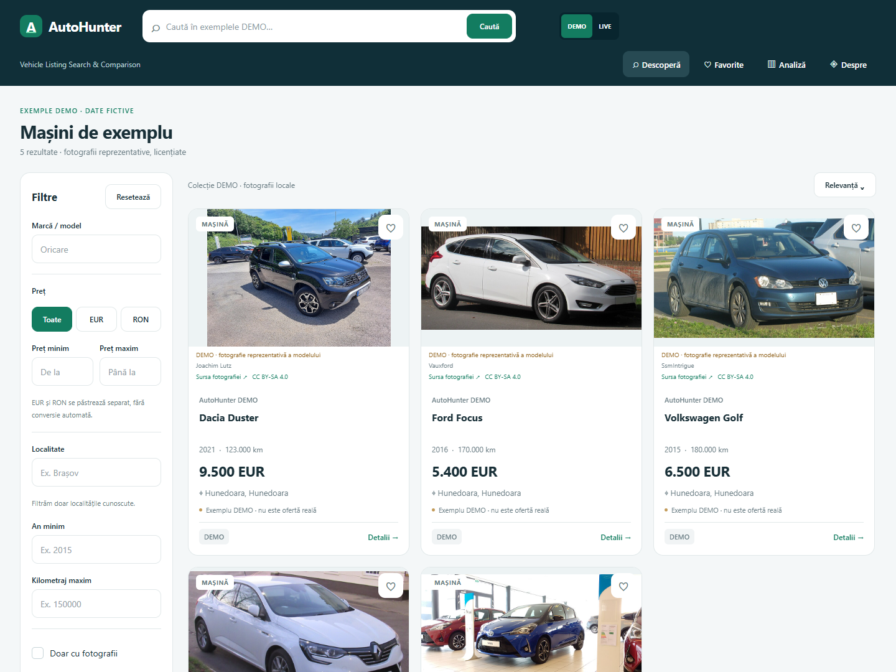
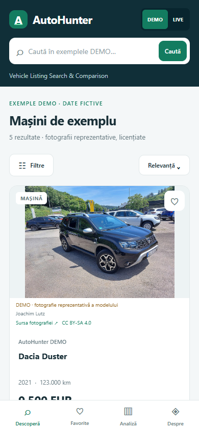
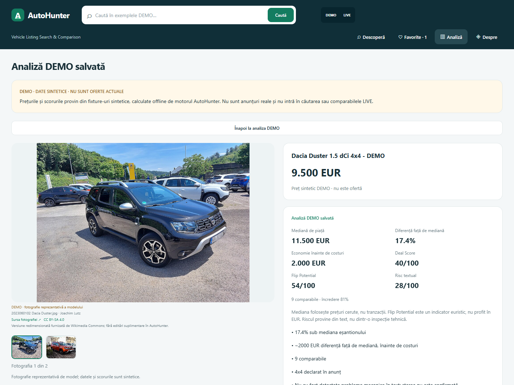
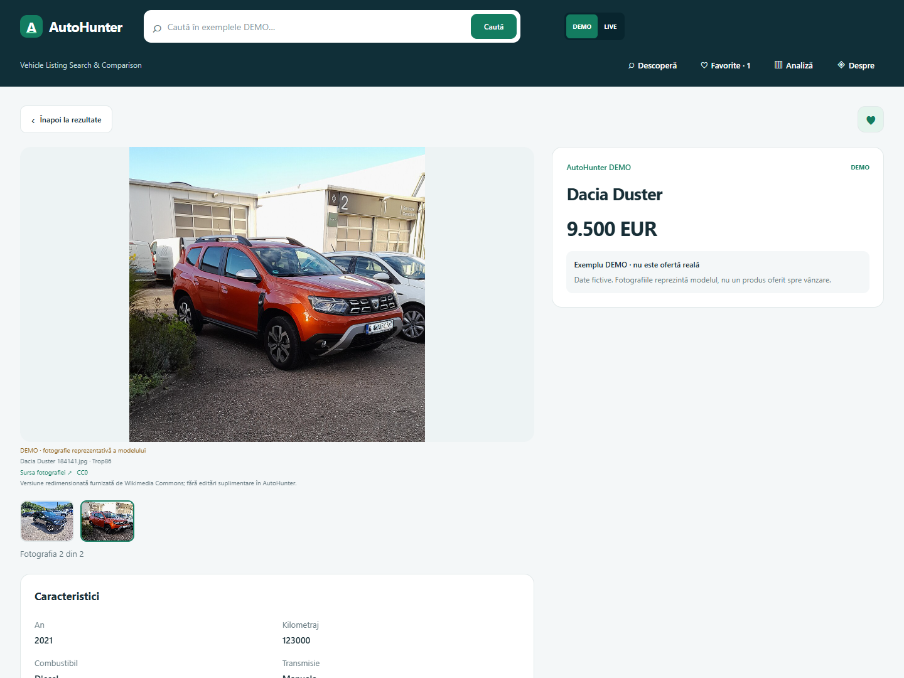

# AutoHunter — Vehicle Listing Search & Comparison

A focused portfolio project for discovering and comparing vehicle listing information. Built with a **TypeScript / Fastify backend** and a **React Native / Expo client** for web and Android.

AutoHunter integrates a real external search API, keeps unknown data explicit, and separates LIVE discovery from a small, reproducible DEMO. The interface is in Romanian.



## What it does

- **LIVE search:** discovers indexed listing links through the official Brave Web Search API.
- **Normalization and deduplication:** cleans display fields and removes duplicate canonical URLs without merging cars just because their model or price matches.
- **Honest availability:** distinguishes confirmed, unverified and unavailable records. Known-unavailable reports are excluded, including from cached results.
- **Local comparison:** filter by model, price, year, mileage or known location; sort by relevance, price or discovery time. Unknown fields stay unknown and currencies remain distinct.
- **Favorites:** saves user-selected links locally, with separate favorites for DEMO samples.
- **Responsive UI:** consistent result cards, a desktop filter sidebar, a mobile filter sheet, useful details and loading/error/empty states.
- **Offline sample content:** five synthetic car examples with licensed, locally stored model-reference photographs, attribution and galleries.
- **Saved synthetic analysis:** the original estimator, Deal Score and Flip Potential run on offline synthetic fixtures. A separate snapshot view demonstrates their output with explicit DEMO labels; these are not real offers or current market valuations.

There is no automatic scraping of marketplace pages, no invented live inventory and no unsupported Deal Score in the interface.

Open **Analiză DEMO salvată** to inspect a synthetic analysis snapshot. See [analysis boundaries](docs/RECOVERED_ANALYSIS.md). Saved DEMO records are never used as current LIVE comparables.

## DEMO and LIVE are different

|                       | DEMO                                              | LIVE                                                                                      |
| --------------------- | ------------------------------------------------- | ----------------------------------------------------------------------------------------- |
| Data                  | Five existing synthetic car fixtures              | Actual Brave search responses                                                             |
| API key               | Not required                                      | Brave key configured in the backend                                                       |
| Availability          | Not a real offer                                  | Unverified unless separately confirmed; a URL is not proof of an active sale              |
| Photos                | Local, licensed model references, clearly labeled | Original-item photos only with explicit display rights; otherwise an original-source link |
| Favorites             | Sample IDs, separate storage key                  | User-selected canonical URLs and save times                                               |
| Network to publishers | None                                              | None from the backend                                                                     |

**Brave is a discovery API, not a complete or current OLX/Autovit inventory feed.** Indexed prices, years and mileage can be old and are labeled accordingly. Missing fields are not inferred from unrelated vehicles. Expired reports are user evidence, not an automatic publisher verification service.

The current scope does not include authentication, payments, commercial hosting, background crawling or a guaranteed market valuation. Tractor/tool engines and their regression tests are retained as earlier work but are outside the primary portfolio interface.

## Run locally

Tested with Node.js 24 and npm 11. Use a current Node.js 24 installation. Both packages have lockfiles; no global Expo installation is needed.

After cloning this repository:

```sh
npm ci
npm ci --prefix mobile
cp .env.example .env
cp mobile/.env.example mobile/.env
```

The `cp` commands also work in PowerShell. On an existing checkout, preserve your local environment files instead of overwriting them.

Start the backend in one terminal, from the repository root:

```sh
npm run api
```

Start Expo Web in a second terminal, also from the root:

```sh
npm run web --prefix mobile -- --offline
```

Open **http://localhost:8082**. The app starts in **DEMO**, with five examples and local photographs. The API is at **http://localhost:3000**; `/health` checks the server. Stop each foreground server with **Ctrl+C**.

### Enable real Brave discovery

Create a Brave Search API account and key using the [official dashboard](https://api-dashboard.search.brave.com/). Put the key **only** in the root `.env`:

```dotenv
AUTOHUNTER_MODE=demo
AUTOHUNTER_LIVE_ENABLED=true
BRAVE_SEARCH_API_KEY=your-real-key
BRAVE_SEARCH_MAX_RESULTS=20
```

Keep `AUTOHUNTER_MODE=demo`: it enables the local sample/image routes. The separate `/api/live/search` route still uses Brave when you choose **LIVE** in the UI. No API call is made without the configured key. The backend reads Brave configuration at request time; restart it after code changes.

Brave usage may incur provider charges. Check the [current official plans](https://brave.com/search/api/) and your account limits. A new query uses at most one request; a bounded five-minute memory cache and local filters limit repeated calls. No automatic paid pagination or retries are enabled. A Brave subscription does not grant rights to republish third-party photographs or confirm listing availability.

Never put the key in `EXPO_PUBLIC_*`, commit `.env`, or send it to the frontend.

### Android and mobile web

The same UI and shared pure TypeScript utilities are used on Android. For a physical device, set `EXPO_PUBLIC_API_BASE_URL` in `mobile/.env` to your PC's LAN address, for example `http://YOUR_PC_IP:3000`, and allow the backend to listen on the LAN with `HOST=0.0.0.0`. Use the same network and restart Expo after changing its environment.

```sh
npm start --prefix mobile
```

Local Expo Web resolves the API using the browser host on port 3000, avoiding stale Wi-Fi IPs. Native Android uses its explicit API URL; `localhost` on a phone means the phone itself.

Android/Hermes bundling is checked. A production APK, store deployment and physical-device testing are not claimed.

```sh
npm run export:android --prefix mobile
```

Web and Android exports use separate ignored output folders, so exporting Android does not remove the web build.

## Configuration

| Variable                   | Location      | Purpose                                                         |
| -------------------------- | ------------- | --------------------------------------------------------------- |
| `AUTOHUNTER_MODE=demo`     | Root `.env`   | Enables the existing local fixture/image routes                 |
| `HOST`, `PORT`             | Root `.env`   | Backend bind address and port; default example is loopback:3000 |
| `AUTOHUNTER_LIVE_ENABLED`  | Root `.env`   | Explicit Brave integration switch                               |
| `BRAVE_SEARCH_API_KEY`     | Root `.env`   | Server-only provider credential                                 |
| `BRAVE_SEARCH_MAX_RESULTS` | Root `.env`   | Provider result cap, clamped to 1–20                            |
| `EXPO_PUBLIC_API_BASE_URL` | `mobile/.env` | Public backend address, never a secret                          |

## Architecture

```text
Expo web / Android
  ├─ DEMO → GET /api/demo/cars → existing fixtures + local licensed images
  └─ LIVE → POST /api/live/search → LiveService → BraveSearchAdapter → Brave API
                                  ├─ canonical URL deduplication
                                  ├─ bounded transient cache
                                  └─ local unavailable reports
```

- `src/api/`: Fastify composition, route validation and HTTP error handling.
- `src/live/`: provider integration, service orchestration, provenance, availability and the retained analysis bridge.
- `src/demo/`: explicitly tagged portfolio samples and an offline synthetic analysis snapshot.
- `src/models/` and `src/discovery/`: shared image/URL rules, normalized listing contracts and exact-identity deduplication.
- `mobile/src/live/`: the finished car-search UI and reusable card, media, detail, filter and favorite components.
- `fixtures/images/`: local photographs, per-image rights metadata and source/author/license credits.
- `tests/` and `mobile/tests/`: backend/API and client regression tests.

See [public data provenance](docs/PUBLIC_DATA.md), [architecture and trade-offs](docs/ARCHITECTURE.md) and [interview notes](docs/INTERVIEW.md). Comparing visible listing fields is supported; complete cross-market inventory and resale-profit prediction are not claimed.

## Validate

```sh
npm run validate -- --core
npm run format:check
npm run check:public
```

The core command runs backend/client tests, backend build and both TypeScript checks without live publisher access. It retains the earlier category/analysis regressions as well as the focused portfolio tests.

See the [local validation snapshot and its limits](docs/VALIDATION.md).

For reproducible browser checks:

```sh
npm run build
npm run web:export
npx playwright install chromium
npm run test:browser
```

On Windows, the browser check can use an already installed Microsoft Edge without downloading Chromium. `AUTOHUNTER_BROWSER_PATH` can override the browser executable. The offline browser test starts temporary local test infrastructure and closes it afterwards; it does not stop your development servers. It exercises the actual local DEMO pictures and injected provider responses. **Injected results are test data, not proof of a live API call.**

For the explicit real-provider smoke test, with the backend and Expo already running and your own Brave key configured:

```sh
npm run test:live
```

This may consume a Brave request. It checks actual discovery and rendering, not whether a publisher still has the car in stock. Do not run this command in credential-free CI.

The GitHub Actions workflow runs credential-free validation, formatting, the public-file check, a web export and the offline browser check. Its first remote run remains to be observed after you publish; no green CI badge or deployment is assumed.

## Screenshots and licenses







These screenshots are captured from the actual DEMO UI, not generated product images. Synthetic listing values, computed example scores and representative photos are explicitly marked in the app. Individual photo licenses, attribution and modifications are preserved in [image credits](fixtures/images/CREDITS.md) and the per-listing `rights.json` files. They also apply to photographs shown in screenshots; they are not relicensed as application code.

Regenerate the curated screenshots with `npm run test:browser -- --screenshots` after exporting the web app. Local execution logs, caches, imported user data and environment files are ignored by Git. The public-file check scans publishable files, Git history and configured secrets in web/Android export artifacts without printing secret values.
