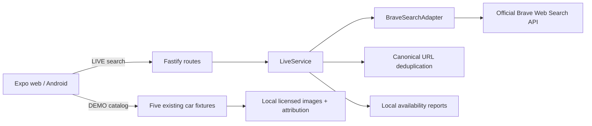

# Architecture

AutoHunter is a local portfolio application for vehicle listing discovery and comparison. It has one Node.js backend and one Expo client that renders on web and Android. The interface is in Romanian. It deliberately does not claim complete marketplace coverage or verified inventory.

## Backend boundaries

- `src/api/server.ts` composes Fastify and registers routes. API secrets remain on the server.
- `src/live/brave.ts` owns the external HTTP request, source-domain/path validation, timeouts, provider errors and request pacing. Publisher pages and images are not fetched.
- `src/live/service.ts` combines discovery results, canonical URL deduplication, transient caching and availability reports. Dependencies can be injected for deterministic tests.
- `src/live/indexFacts.ts` extracts conservative display hints, including their source field and evidence. These hints are not confirmed attributes or scoring inputs.
- `src/models/ListingUrl.ts` is shared, Node-free URL validation and canonicalization.
- `src/demo/vehicles.ts` reads five existing synthetic car fixtures and their image manifest. Its response is explicitly DEMO and cannot pass the LIVE client decoder.
- `src/discovery/normalize.ts` retains the broader normalized listing model and exact-identity deduplication used by the earlier analysis infrastructure.

The legacy tractor/tool engines, category endpoints, parser fixtures and tests are retained. They are not part of the portfolio's primary interface. `mobile/LegacyApp.tsx` preserves the earlier UI for reference and is not imported by the production entry point. The unused advanced-import component was removed; the older backend import contract remains tested.

## Data contracts and uncertainty

LIVE discovery records may have unknown price, location, year, mileage or images. Missing values remain missing. `indexFacts` can expose an explicitly stated indexed price or mileage for display, with provenance. Financing/down-payment ambiguity suppresses the inferred total price. EUR and RON are not silently converted or numerically ranked against each other.

The client uses a `DisplayOffer` union for actual LIVE records and explicitly tagged `DemoVehicle` samples. LIVE and DEMO have different response decoders and separate favorite storage keys. Switching modes clears the displayed response before loading the other dataset; mode changes are disabled while a request is running.

Availability states distinguish unverified discovery, fresh manual confirmation, stale confirmation and unavailable/expired records. Reports have their own timestamp and USER_REPORT provenance. A report can be undone; undo does not mark an offer active. Confirmed-unavailable records are excluded from the default search response, including cached hits. `ACTIVE_VERIFIED` is reserved for an authoritative source; Brave does not produce it.

## Deduplication

Search results are deduplicated by canonical original URL. Tracking parameters such as `utm_*`, `fbclid` and `gclid` and fragments are removed; meaningful query parameters are retained and sorted. The normalized discovery layer can also join exact source IDs and explicitly provided cross-source identifiers while preserving origins and price conflicts.

Two cars with the same model and price are not automatically duplicates. There is no fuzzy VIN inference or claim of perfect cross-platform identity resolution. This avoids merging distinct vehicles.

## Request and storage behavior

A new LIVE query makes at most one Brave request, with at most 20 provider results. The server keeps at most 20 queries in memory for five minutes. Filtering, sorting, availability tabs and favorites are local operations. The adapter has conservative spacing and honors HTTP 429 Retry-After; it does not retry automatically.

The cache is process-local, not a distributed cache. Restarting the server clears it. There is no persistent database of Brave titles, snippets or photographs. LIVE bookmarks store only the user-selected canonical URL, category and save time. Availability reports are separate local files under ignored `data/imports/`.

## Images

DEMO contains synthetic listing data with locally stored, licensed model-reference photographs. Both cards and details identify them as illustrative DEMO images. Author/source/license metadata is visible, with complete credits in `fixtures/images/CREDITS.md`.

LIVE images require actual-item presentation, explicit display rights and evidence, and a matching listing ID and original URL. No such photo source is currently configured. Missing or broken photos use a compact original-source link, never a substitute vehicle image.

## Frontend and tests

`mobile/App.tsx` mounts the existing search interface. Cards, media/gallery, filters, favorites and details are reusable components in `mobile/src/live/`. The web layout measures its available result width; narrow screens use a filter sheet and bottom navigation. Reduced-motion preferences disable the optional animations.

The API base resolver uses the current host for local Expo Web on port 8082, avoiding stale Wi-Fi addresses. Native Android uses its explicit public API URL. Metro watches shared TypeScript and resolves NodeNext-style `.js` imports without changing the backend module system. Runtime shared utilities remain Node-free; backend-only contracts are imported with `import type`.

Unit and API integration tests cover normalization, deduplication, data provenance, image rights, error handling and the retained analysis engines. The offline Playwright check uses real local DEMO images and injected Brave responses, while `test:live` is an explicit, separate check using the user's actual API key. Mocked provider tests are never reported as proof of a live provider integration.

## Scope limits

This is a single-user local application, without authentication, production hosting, payments, background crawling or automatic publisher availability verification. Deal Score engines remain in the repository, but unsupported scores and opportunity ranking are hidden from the portfolio UI. Price comparison means comparing the known listing fields, not predicting a guaranteed resale profit.
